---
## Author
author:
  name: Седохин Даниил Алеквсеевич

## Title
title: "Лабораторная работа"
subtitle: "Номер 3"
license: "CC BY"
---

# Цель работы

Освоить применение циклов, функций и сторонних пакетов Julia для решения задач линейной алгебры и работы с матрицами.

# Выполнение лабораторной работы

Выполнены четыре примера из теоретического раздела. Цикл while выводит числа от 1 до 10. Цикл while по массиву имён печатает приветствия для каждого друга. Цикл for с шагом 2 выводит нечётные числа от 1 до 9. Цикл for по массиву имён делает то же, что и while, но без счётчика. Показаны базовые синтаксисы циклов.
(рис. [-@fig-001]).

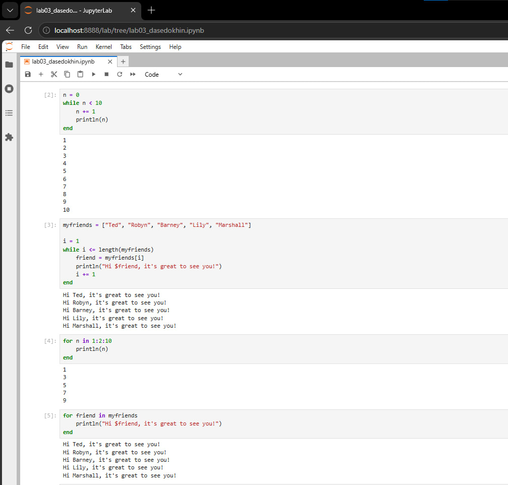{#fig-001}

Тернарный оператор и его эквивалент через if/else возвращают 10 при x = 5, y = 10. Определены функции sayhi и f. Функция sayhi печатает приветствие по имени, функция f возвращает квадрат числа. Вызваны обе функции: получено приветствие для C-3PO и число 1764.
(рис. [-@fig-002]).

{#fig-002}

Показаны короткие формы функций через знак равенства и анонимные функции через стрелку. Продемонстрирована разница между sort и sort!: первая не меняет массив, вторая сортирует на месте. Выполнен пример broadcasting — функция применена к массиву поэлементно через точку. Создана матрица генератором и применена функция возведения в квадрат.
(рис. [-@fig-003]).

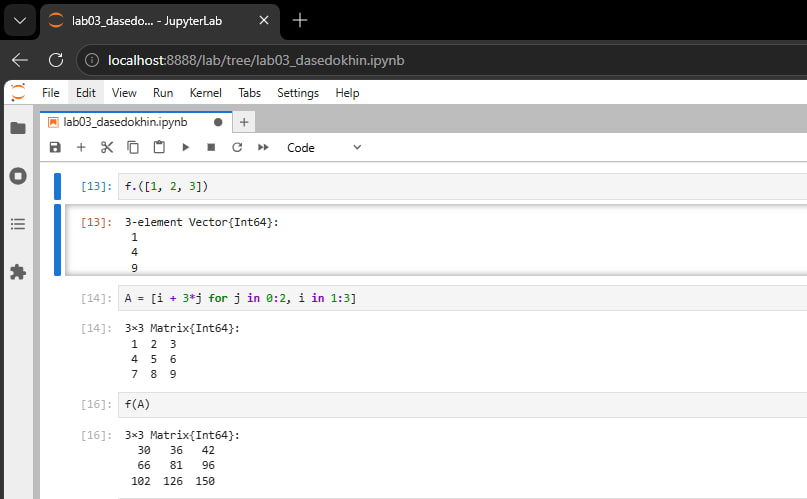{#fig-003}

Выполнена установка пакета Colors через менеджер пакетов, затем подключение через using. Создана палитра из 100 различимых цветов. Сгенерирована матрица три на три из случайных цветов. Визуально отображены девять цветных квадратов.
(рис. [-@fig-004]).

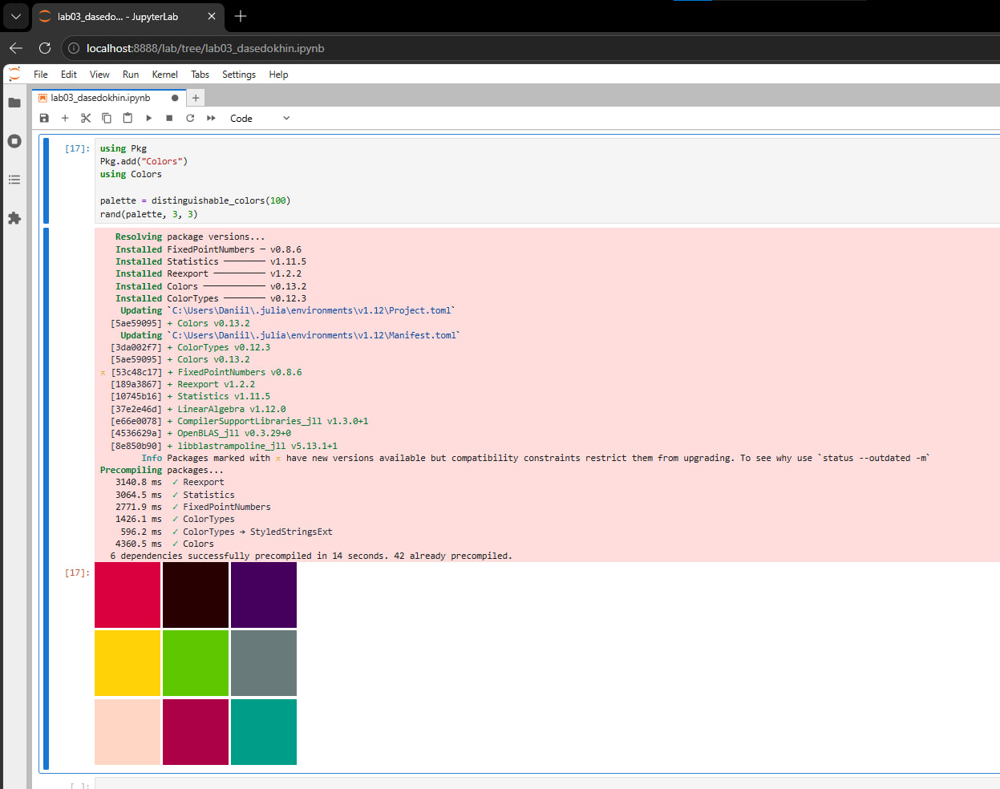{#fig-004}

Цикл for перебирает числа от 1 до 100. Для каждого числа проверяется чётность через остаток от деления на два. Если число чётное, печатается пара: число и его квадрат. Выведены все чётные числа и их квадраты.
(рис. [-@fig-005]).

{#fig-005}

Та же задача решена циклом while. Счётчик инициализируется единицей, условие — пока счётчик не больше 100. Внутри проверяется чётность и печатается результат, затем счётчик увеличивается. Результат идентичен предыдущему.
(рис. [-@fig-006]).

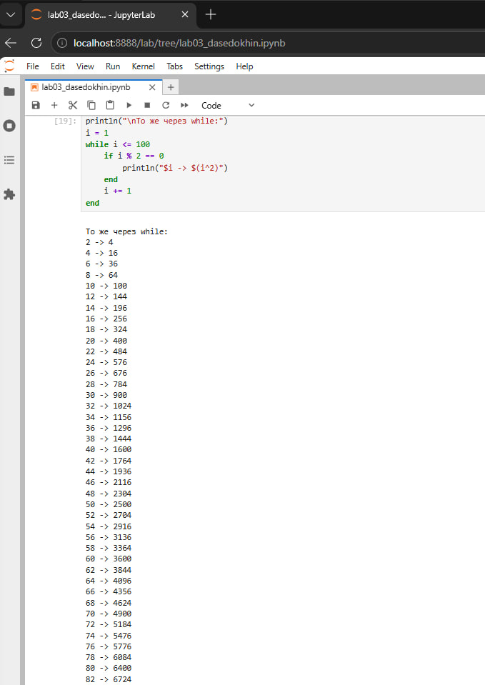{#fig-006}

Создан пустой словарь, где ключ — целое число, значение — целое число. Цикл заполняет словарь: для каждого числа от 1 до 100 добавляется пара ключ-значение, где значение — квадрат числа. Выведены первые десять пар.
(рис. [-@fig-007]).

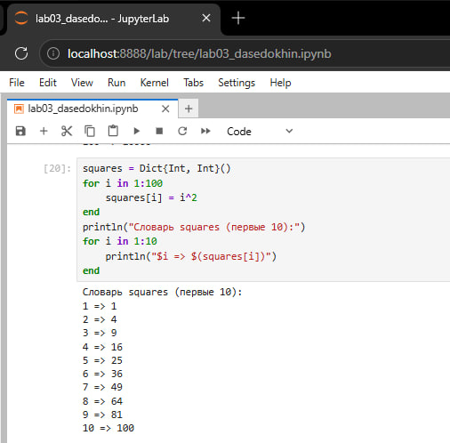{#fig-007}

Создан массив из квадратов чисел от 1 до 100 с помощью генератора. Выведены первые десять элементов и длина массива. Генератор позволяет компактно создавать массивы без явного цикла.
(рис. [-@fig-008]).

{#fig-008}

Определены две функции. Первая использует полный условный оператор, вторая — тернарный. Обе принимают число и возвращают строку «чётное» или «нечётное». Проверены на числах 4 и 7. Результаты совпадают.
(рис. [-@fig-009]).

{#fig-009}

Определена функция, которая принимает число и возвращает число плюс один. Проверена на числах 5, 42 и минус 3. Результаты: 6, 43 и минус 2.
(рис. [-@fig-010]).

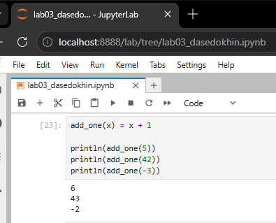{#fig-010}

Создан массив из пяти чисел. Функция add_one применена двумя способами: через map и через точку после имени функции. Оба способа дали одинаковый результат — массив чисел, увеличенных на единицу. Проверка на равенство вернула истину.
(рис. [-@fig-011]).

{#fig-011}

Создана матрица три на три. Вычислена третья степень матрицы — это матричное умножение матрицы на себя три раза. В данном случае результат — нулевая матрица, так как исходная матрица вырождена.
(рис. [-@fig-012]).

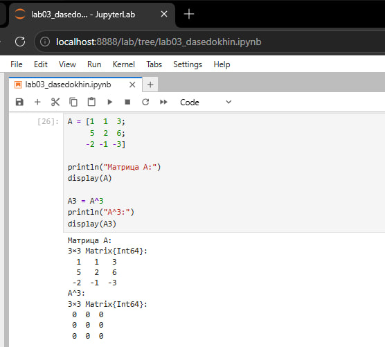{#fig-012}

Создана копия исходной матрицы. Третий столбец заменён
поэлементной суммой второго и третьего столбцов исходной матрицы. Показан результат: в третьем столбце теперь суммы соответствующих элементов.
(рис. [-@fig-013]).

{#fig-013}

Создана матрица пятнадцать на три. Первый столбец заполнен числом 10, второй — минус 10, третий — снова 10. Вычислено произведение транспонированной матрицы B на B. Получена квадратная матрица три на три, симметричная относительно главной диагонали.
(рис. [-@fig-014]).

{#fig-014}

Созданы две матрицы шесть на шесть. Первая заполнена нулями, вторая — единицами. Эти матрицы используются как заготовки для построения более сложных структур.
(рис. [-@fig-015]).

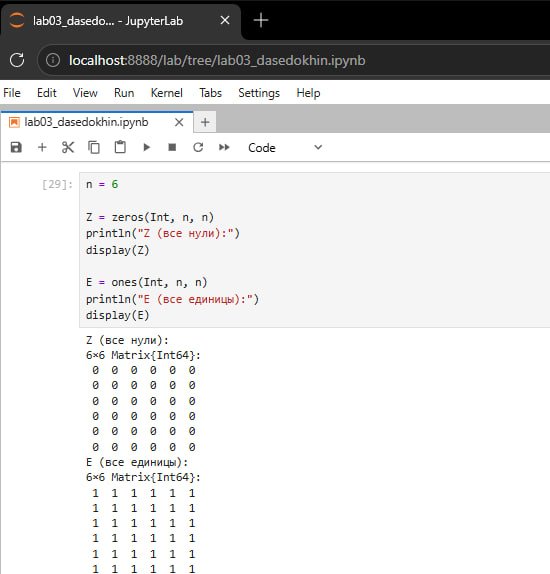{#fig-015}

Построена матрица шесть на шесть, в которой единицы стоят на первой наддиагонали, то есть на одну клетку правее главной диагонали. Остальные элементы — нули. Это оператор сдвига вправо.
(рис. [-@fig-016]).

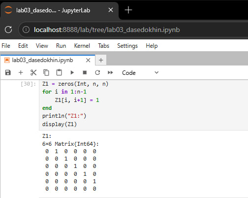{#fig-016}

Построена матрица, в которой единицы стоят там, где сумма номера строки и номера столбца чётная и одновременно расстояние от главной диагонали не превышает двух клеток. Получена ленточная матрица с шахматным узором.
(рис. [-@fig-017]).

{#fig-017}

Построена матрица, которая получается из предыдущей матрицы Z2 отражением по горизонтали: строка с номером один берётся из строки с номером шесть, строка два — из строки пять, и так далее.
(рис. [-@fig-018]).

{#fig-018}

Построена матрица, в которой единицы стоят на клетках с чётной суммой номера строки и номера столбца. Получается шахматный узор из единиц и нулей.
(рис. [-@fig-019]).

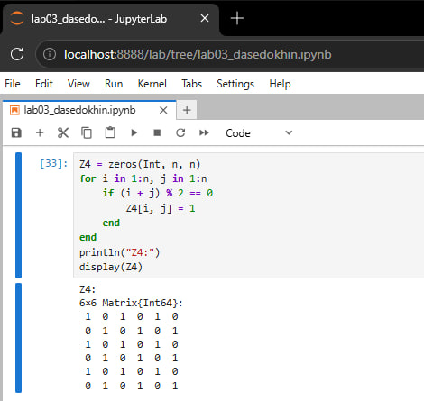{#fig-019}

Определена функция, аналогичная функции outer из языка R. Она принимает два массива и операцию. Если операция — умножение, выполняется матричное умножение через тройной цикл. Для других операций каждый элемент результата равен применению операции к паре элементов из первого и второго массивов. Функция возвращает матрицу.
(рис. [-@fig-020]).

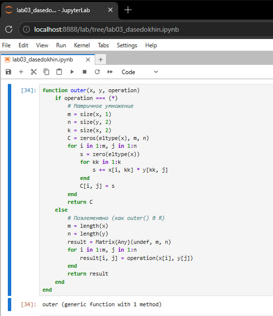{#fig-020}

С помощью функции outer построена матрица пять на пять, где каждый элемент равен сумме номера строки и номера столбца, уменьшенной на два. Получена таблица сложения с числами от нуля до восьми.
(рис. [-@fig-021]).

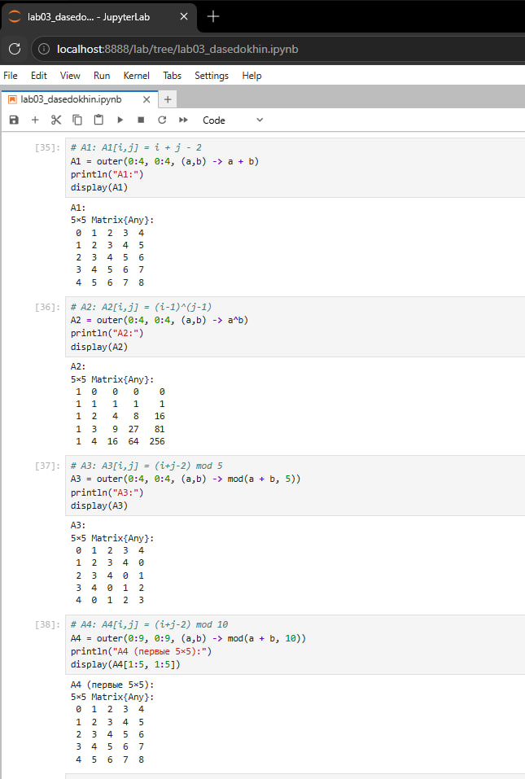{#fig-021}

Построена матрица, где каждая строка содержит степени числа, соответствующего номеру строки минус один. Первая строка — нули, вторая — единицы, третья — степени двойки, четвёртая — степени тройки, пятая — степени четвёрки.
(рис. [-@fig-022]).

{#fig-022}

Построена матрица пять на пять, где каждый элемент равен сумме номера строки и номера столбца, уменьшенной на два и взятой по модулю пять. Получена циклическая таблица сложения.
(рис. [-@fig-023]).

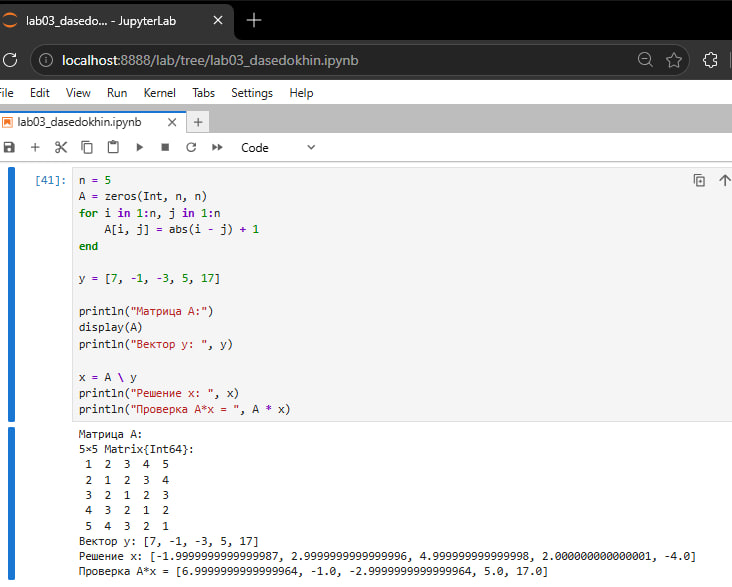{#fig-023}

Построена матрица десять на десять, аналогичная предыдущей, но по модулю десять. Показаны первые пять строк и пять столбцов. Видно, что числа возрастают, а после девяти снова идут с нуля.
(рис. [-@fig-024]).

{#fig-024}

Построена матрица девять на девять. На главной диагонали нули. Ниже диагонали элемент равен разности номера строки и номера столбца. Выше диагонали — девять минус разность. Каждая строка является сдвигом предыдущей. Это циркулянтная матрица.
(рис. [-@fig-025]).

{#fig-025}

Построена матрица пять на пять, где элемент равен модулю разности номера строки и номера столбца плюс один. Задан вектор правой части. Система решена оператором обратный слэш. Получено решение, близкое к целым числам: минус два, три, пять, два, минус четыре. Проверка умножением матрицы на решение дала исходный вектор правой части с точностью до погрешности вычислений.
(рис. [-@fig-026]).

{#fig-026}

С
помощью генератора случайных чисел создана матрица шесть на десять. Каждый элемент — случайное целое число от одного до десяти с повторениями. Для воспроизводимости установлено зерно генератора.
(рис. [-@fig-027]).

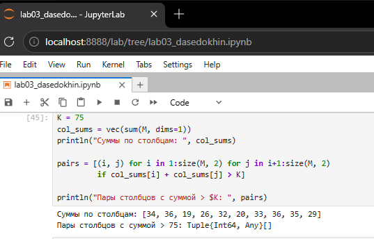{#fig-027}

Для каждой строки матрицы подсчитано количество элементов, строго больших четырёх. Найдены строки, в которых число семь встречается ровно два раза — это строки два и пять. Перебраны все пары столбцов, проверено, превышает ли сумма их сумм число семьдесят пять — таких пар не найдено. Вычислены две двойные суммы: первая примерно минус шестьсот тридцать девять тысяч, вторая примерно минус девяносто тысяч.
(рис. [-@fig-028]).

{#fig-028}

# Выводы

В ходе лабораторной работы были освоены основные управляющие структуры языка Julia: циклы while и for, условный оператор и тернарный оператор, функции разных форм записи, включая анонимные и функции высшего порядка. Изучены способы работы с массивами и матрицами: создание через генераторы, поэлементные операции, матричное умножение, транспонирование, срезы и замена столбцов. Освоено подключение сторонних пакетов через менеджер пакетов и их использование в вычислениях. Решены задачи линейной алгебры: вычисление степеней матриц, решение системы линейных уравнений, построение структурированных матриц через функцию внешнего произведения. Получены навыки работы с генератором случайных чисел, подсчёта элементов по условию, поиска строк и пар столбцов, удовлетворяющих заданным критериям. Все задания выполнены, результаты совпадают с ожидаемыми. Цель работы достигнута.
